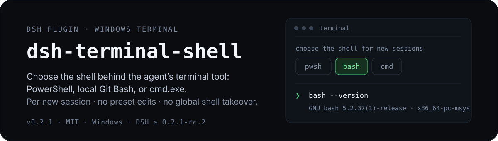
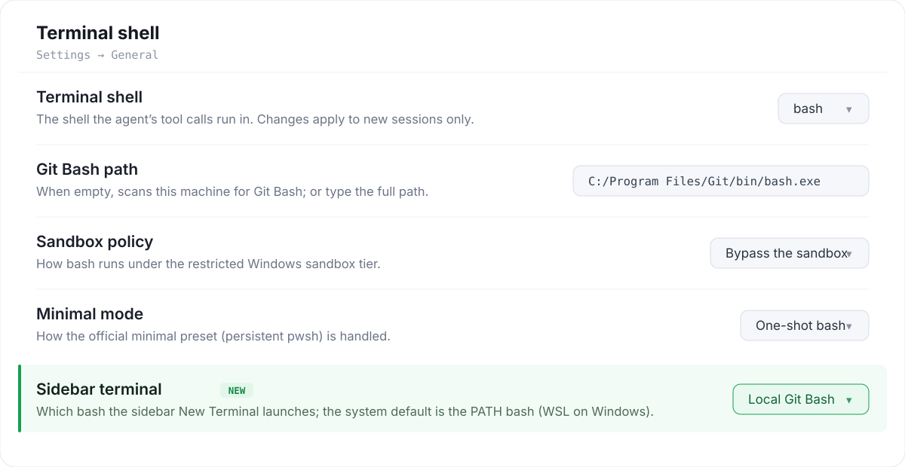

<p align="center">
  
</p>

# dsh-terminal-shell

[English](README.md) | 中文

在 Windows 上选择智能体调用的终端工具背后用哪个 shell：**PowerShell**（`pwsh`）、**本机 Git Bash**（`bash`），或 **`cmd.exe`**（`cmd`）。在 **设置 → 通用** 里一个开关，**仅对新会话生效**：不改任何 preset 文件，不接管全局 `ctx.shell`。

`v0.2.1` · MIT · Windows（DSH Desktop / Web shell） · `engines.node` `>=22` · `engines.dsh` `>=0.2.1-rc.2 <0.3.0`

## 为什么要这个插件

DSH 0.2.1-rc.2 每个平台只带**一个**终端，Windows 上那个是 PowerShell：bash 家族被 `dsh-base` 里的 `!!js process.platform === 'win32'` 断言关掉，而 `ctx.shell` 是**单实例服务**（同一 context 内注册第二个会抛 `service "shell" has been registered`）。所以 Windows 会话里既没有 bash 执行器，也没有 `bash` 工具。

社区里常见的几种绕法，各有代价：

| 做法 | 代价 / 局限 |
|---|---|
| 改 `dsh-base` / profile 的平台断言 | 要动第一方组合；只影响那一个平面；需重启 |
| 自研 PTY / 自研工具 | 重写 60KB+ 的工具契约；容易与官方行为漂移 |
| 装一个**全局** shell 替换器 | 会让**所有**会话（含没选的）跟着变；与宿主执行器冲突 |

**本插件做的是「会话级隔离替换」**，这正是它的优势：

- **只对新会话、且只对你切换过的那个会话生效。** 执行器只组装进每个新会话自己的 `isolate('shell')` 子树，宿主平面和其它会话都不动，卸载后无残留。
- **三种方言、一个开关，装上什么都不变。** `dialect` 默认 `pwsh`，开箱行为与官方完全一致。
- **不写死任何可执行文件路径。** Git Bash 在每台机器上运行时发现，同一个仓库放哪儿都能用。
- **顺带覆盖侧边栏。** 多一个选项，让侧边栏 **新建终端 → 选择 Shell** 菜单启动本机 Git Bash，而不是 WSL 的 `bash`——原版菜单做不到这点。

除了 Git Bash，**`cmd`** 方言用于你想要 Windows 原生行为、而非 POSIX 层的场景：原汁原味的 `cmd.exe` 批处理语义（`.cmd` 脚本、`%VAR%` 变量展开、原生管道与重定向），且不依赖 MSYS。它是复用官方工具契约的一次性执行器，模型可像操作系统本身那样驱动纯 `cmd`。

超时、输出溢出、abort 归类、后台任务、`sandbox_permissions` 提权、会话 cwd、工具卡片、退出码标记等一律继承或复用官方实现。

### 工作原理

在 `agent/created` 时，插件只对一个新会话做如下装配：

```
shellCtx = agentCtx.isolate('shell')                 // 该 agent 私有的 shell realm
shellCtx.plugin(GitBashExecutor, {...})              // 执行器只在这个子树里可见
shellCtx.plugin(ToolBash, {...})                     // 注册出的 bash 落在 agent 自己的工具层
agentCtx.tools.restrict({ deny: ['pwsh'] })          // 只过滤「继承来的」工具
agentCtx.systemPrompt.section({ name: 'tool:pwsh', text: '' })  // 空文本 = 渲染时丢弃
```

`restrict` 只隐藏**继承层**，所以它恰好移除 preset 带进来的 `pwsh`，不影响本层注册的 `bash`（`cmd` 方言同时 deny `pwsh` + `bash`）。各步在会话结束时逆序释放，中途失败则回滚。只对新会话生效——工具目录在会话创建时装配，运行中无法替换。

<p align="center">
  
</p>

> **设置 → 通用**下的 **Terminal shell** 行（bash 方言）。高亮的最后一行 **侧边栏终端**，就是让侧边栏新建终端使用本机 Git Bash 的选项。

---

## 安装 / 启用

**前置条件：** Windows；DSH Desktop / Web shell `>=0.2.1-rc.2 <0.3.0`；用 `bash` 需本机装有 Git for Windows / MSYS2 / Cygwin；用 `cmd` 无需额外安装。

和其它 profile 插件一样安装，二选一：

- **在应用内：** 打开 **插件 → 添加插件**，填入包名 `dsh-terminal-shell`（或本仓库地址、本地目录路径），点 **安装**，再点 **立即启用**。
- **命令行：** `dsh plugin --profile <profile> add dsh-terminal-shell` —— 它会在 profile 内运行 pnpm，并自动把该 bundle 注册进 profile。也可换成本仓库地址或本地目录路径。

包自带 `dsh.bundle.patch`，只插入一行、不固定任何可执行文件路径：

```yaml
- insert:
    - id: terminal-shell
      name: dsh-terminal-shell
      disabled: !!js process.platform !== 'win32'
```

**安装或升级后必须重启 DSH**——运行期插入的行只进入组合树，`apply` 要重启后才会被调用。在你切换方言之前，`dialect` 一直是 `pwsh`。

### 启用

重启后，**设置 → 通用** 底部会出现新的 **Terminal shell** 行（`settings.general.item`，id `terminal-shell`，order `60`，locale `terminal-shell`）。在上面选方言即可；每个控件与 [配置参考](#配置参考) 里的字段一一对应。

<details>
<summary>原始界面截图（bash / cmd，中文界面——第一张早于「侧边栏终端」改名）</summary>


</details>

---

## 用法

**行布局。** 与官方通用设置行一致：左侧标题 + 一行说明 + 右侧控件，沿用官方设计变量、跟随主题。**顺序：** `bash` = 路径 → 沙箱策略 → 极简模式 → **侧边栏终端**；`cmd` = 路径 → 沙箱策略 → 极简模式 → 代码页；`pwsh` 只显示方言行。

**切换方言即触发一次扫描**——选 shell 本身就是扫描，没有单独的「检测」按钮。路径框平时是可输入的输入框，扫描出多个候选时变成下拉。已选且仍有效的路径不会被后续扫描覆盖，写入或扫描失败会自动重试一次，挂载时既不扫描也不写配置。

**沙箱策略**（`bash` 用 `confinedPolicy`，`cmd` 用 `cmdConfinedPolicy`）：

| 取值 | 行为 |
|---|---|
| `Bypass the sandbox`（`unconfined`） | 受限 Windows 档位下直接以普通权限启动、不调 `ctx.sandbox.confine()`；调用立刻成功，但命令**不受文件沙箱约束** |
| `Request permission`（`escalate`） | 先按官方方式进沙箱；MSYS 启动失败被标为 `denied`，模型收到官方提权提示后改用 `sandbox_permissions: danger-full-access` 重试 |

两者的默认值不同是有意为之：**`bash` 默认 `unconfined`**，因为 MSYS2 / Git Bash 在受限 Windows token 下无法启动（`NtCreateDirectoryObject` → `0xC0000022`），若默认 `escalate` 则每条命令都要先失败一次再走审批；**`cmd` 默认 `escalate`**，因为 `cmd.exe` 在受限 token 下能正常启动，走真沙箱既安全又不失败。审批完全由第一方工具处理，插件只把 MSYS 启动失败归类为 `denied`。

**极简模式**（`minimalMode`，仅 `bash`）：官方 `minimal` 预设带一个持久 pwsh 终端，所以 `minimal` 会话需要一次决定——`leave`（保留 pwsh）、`oneshot`（切成一发式 bash，默认）、`variant`（额外注册持久 `minimal-gitbash` 预设，官方 `minimal` 不动，无引用时自动移除，需对每个新会话单独选择）。

**控制台代码页**（`cmdCodePage`，仅 `cmd`）：执行前先跑 `chcp <codePage>>nul`；默认 `65001`（UTF-8），是唯一能让非 ASCII 输出保持完整的取值。

**Bash 发现顺序**（`bashPath` 为空时）：显式 `bashPath` → `bashCandidates` → 注册表 `HKLM\SOFTWARE\GitForWindows` 的 `InstallPath` → `%ProgramFiles%\Git` 等 → MSYS2 → Cygwin → 由 PATH 上的 `git.exe` 反推。**WSL 被硬排除**（`System32\bash.exe`、`WindowsApps\bash.exe` 是不同操作系统/文件系统）。发现只做文件系统 `stat` 加一次异步 `reg.exe query`，绝不 spawn `bash --version`。

**cmd 发现**（`cmdPath` 为空时）：`cmdPath` → `%ComSpec%` → `%SystemRoot%\System32\cmd.exe`，不扫描磁盘；非 `cmd.exe` 的 `cmdPath` 视为未设置。

**子进程 PATH**：工具链 `bin` → `usr\bin` → `bin` → `usr\local\bin` → `extraPath` → 宿主 PATH，让 MSYS2 工具优先、同时保留原生 `node` / `python`。

---

## 配置参考

所有字段都是 `.volatile()`，经官方 `configForms` 呈现；设置行直接编辑其中一部分，其余仍可写进 profile patch。

| patch 键 | 类型 | 默认 | 含义 |
|---|---|---|---|
| `dialect` | `'pwsh' \| 'bash' \| 'cmd'` | `'pwsh'` | 终端方言 |
| `bashPath` | `string` | `''` | 显式 `bash.exe` 路径；空 = 自动发现 |
| `bashCandidates` | `string[]` | `[]` | 额外的发现根 / 显式路径，在内置顺序之前尝试 |
| `autoDiscover` | `boolean` | `true` | `bashPath` 为空时在会话装配阶段自动发现 |
| `discoverTimeoutMs` | `number` | `1500` | 单次发现的时间上限 |
| `loginShell` | `boolean` | `false` | 传 `-l` 读取登录 profile |
| `extraPath` | `string[]` | `[]` | 追加到子进程 PATH 的目录 |
| `pythonUtf8` | `boolean` | `true` | 导出 `PYTHONIOENCODING=utf-8` |
| `confinedPolicy` | `'unconfined' \| 'escalate'` | `'unconfined'` | `bash` 在受限档位下的行为 |
| `cmdPath` | `string` | `''` | 显式 `cmd.exe` 路径；空 = `%ComSpec%` 回退 |
| `cmdCodePage` | `number` | `65001` | `chcp` 代码页 |
| `cmdConfinedPolicy` | `'escalate' \| 'unconfined'` | `'escalate'` | `cmd` 在受限档位下的行为 |
| `minimalMode` | `'leave' \| 'oneshot' \| 'variant'` | `'oneshot'` | 官方 `minimal` 预设的处理方式 |
| `sidebarBash` | `'system' \| 'gitbash'` | `'system'` | 侧边栏 **新建终端** 用哪个 `bash`；`gitbash` 运行时解析本机 Git Bash 并在内存里覆盖核心控制器 |
| `timeoutMs` / `maxTimeoutMs` | `number` | `120000` / `600000` | 单条命令超时 / 允许的最大值 |
| `maxOutputBytes` / `maxSpillBytes` | `number` | `64000` / `67108864` | 前台输出上限 / 溢出到文件的上限 |
| `graceMs` | `number` | `3000` | 杀进程前的宽限期 |

> `confinedPolicy` / `cmdConfinedPolicy` **只接受** `unconfined` / `escalate`（0.2.1 移除了 `fail`；写 `fail` 会导致 schema 校验失败——见 [诊断](#诊断与排错)）。

---

## 卸载

和你安装时一样卸载：在 **插件** 里打开该插件点 **卸载**（或运行 `dsh plugin --profile <profile> remove dsh-terminal-shell`），再**重启**；新会话回到官方工具。无全局残留（不碰 `ctx.shell`、不改 preset、不往安装目录写东西）。已在 Git Bash / cmd 下打开的会话继续运行（工具在会话创建时固定）。`variant` 预设会随插件一起注销。

---

## 已知限制

### 临时替代方案状态

DSH 目前没有内置的「终端 / shell 选择」能力，所以**在官方能力落地前，本插件是它的临时替代方案**——用官方已发布的执行器与工具，把 Windows 上新会话的终端换掉，受限沙箱档位下的 `confinedPolicy` 同属这段临时接线。官方提供等价能力后即可停用（卸载并重启），新会话即回到官方终端工具。插件不改 DSH 安装目录、不改任何 preset、不接管全局 `ctx.shell`——配置只写进当前 profile 的 patch 层，卸载无需清理——唯有一个刻意例外：`minimalMode: variant` 会以**新增预设** `minimal-gitbash` 的形式注册，官方 `minimal` 原样保留，没有会话再引用它时该预设自行消失（见「用法」）。

### CMD 方言的限制

`cmd` 是唯一**不基于官方 bash 工具**的方言（`src/cmd/tool.ts` 是官方工具的逐字移植）；以下约束都来自 `cmd.exe` / 批处理语义：

1. **一发式批处理**——每次调用都是全新的临时 `.cmd`；`pause`、`set /p` 或任何交互提示会卡到超时。
2. **无法恢复回显**——`cmd.exe /q` 关掉命令回显，只有命令自身的输出会返回；脚本内 `@echo on` 覆盖不了 `/q`。
3. **批处理占位符**——`%0` / `%1`–`%9` / `%*` / `%~dp0` 指向插件的内部脚本，而非你写的命令行；当前目录请用 `%CD%`。
4. **`%VAR%` 按批处理规则展开**——同一行里的 `set` 对同一行的新变量尚不可见。
5. **编码**——非 ASCII 输出取决于控制台代码页（`cmdCodePage`，默认 `65001`）。
6. **`cmdPath` 只接受 `cmd.exe`**——其它值会被客户端和发现逻辑拒绝；留空回退到 `%ComSpec%` → `%SystemRoot%\System32\cmd.exe`。
7. **无持久 PTY**——`cmd` 没有持久终端，也不替换 `minimal` 的持久 shell。
8. **沙箱拒绝标记可能缺失**——中文 Windows 下拒绝信息是 GBK，官方英文签名匹配不上；沙箱仍然生效，插件不伪造该判定。

每次执行都会把 `cmd-<uuid>.cmd` 写进执行器自己的暂存目录（cwd 设为该目录、用裸文件名调用），因为 `cmd.exe` 无法把可安全处理引号的多行命令当作参数接收；`cd /d "<cwd>"` 守卫防止在暂存目录里静默执行，退出码保留为最后一条命令自身的退出码。

---

## 诊断与排错

每个会话写一行到 `%TEMP%\dsh-terminal-shell.log`（用 `DSH_TERMINAL_TOOL_DIAG_FILE` 覆盖路径），例如 `ok ... bash=... source=registry` 或 `skip ... reason=bash-not-found`。`reason` 取值包括 `not-win32` / `dialect-pwsh` / `already-replaced` / `bash-not-found` / `cmd-not-found` / `minimal-left` / `mount-failed` / `cmd-script-failed`。

| 症状 | 处理 |
|---|---|
| 改了设置没反应 | 工具在会话创建时固定——只有**新会话**才会生效 |
| 重启后仍无新工具 | 完全退出并重启宿主，再**新建**会话 |
| `bash-not-found` / `cmd-not-found` | 显式设置 `bashPath` / `cmdPath` |
| 启动报 `confinedPolicy: fail` | `fail` 已不再合法——改用 `unconfined` 或 `escalate` |

监听器全程防御式：任何异常只写进日志，绝不让会话创建失败。

---

## 开发

从源码构建：

```powershell
git clone https://github.com/road-kid/dsh-terminal-shell.git
cd dsh-terminal-shell
npm install
npm run build        # esbuild → lib/index.js、lib/client.js、lib/pty.js
```

源码结构：

```
src/index.ts      插件入口：apply / Config / agent 事件 / 能力探测
src/config.ts     schemastery Config（全部 volatile）+ 每会话快照
src/discover.ts   Git Bash 自动发现（含 WSL 排除）
src/paths.ts      路径运算、校验、PATH 组装
src/executor.ts   GitBashExecutor（继承 LocalBashExecutor，带沙箱分支）
src/confined.ts   受限沙箱启动决策
src/cmd/          cmd 方言：契约、脚本传输、发现、执行器、工具、提示词
src/preset.ts     minimal 预设变体管理（注册 / 注销、引用计数）
src/pty.ts        gitbash 类型持久终端后端入口
src/replace.ts    会话级替换 + 逆序回滚
src/sidebar.ts    把侧边栏 bash 选择应用到核心 terminal-controller（内存中）
src/diag.ts       诊断日志
src/routes.ts     /state 与 /discover 两个只读路由
src/shared/protocol.ts  宿主 / 客户端共享的线上协议
src/client/       「Terminal shell」设置行（index / row / store / api / styles / locales）
src/testing.ts    仅测试用的第二入口（不发布）
```

`npm run typecheck` · `npm run build`（esbuild → `lib/index.js`、`lib/client.js`、`lib/pty.js`）· `npm run check`（依次跑全部：contractcheck 19、clientsmoke 8、selftest 51、rowselftest 19、rendertest 21、cmdunit 37、integration 13、cmdtest 14、ptytests 3）。

第一方 `@deepseek-ai/*` 包在构建时保持 **external**（内联会复制服务类，破坏 cordis 依赖的 `instanceof` / 身份判断）；客户端同样把 `react` 与官方 UI 原子保持 external。类型声明是手写的 `.d.ts`，以免拖入第一方的全部类型图。

架构、决策依据，以及相对官方实现的偏差，见 [`docs/DESIGN.md`](docs/DESIGN.md)。

---

## 兼容性

仅 Windows（`disabled: !!js process.platform !== 'win32'`）。DSH Desktop / Web shell。`engines.node >=22`，`engines.dsh >=0.2.1-rc.2 <0.3.0`。`@deepseek-ai/dsh-llm` 是 `peerDependency`，构建时 external。可与持久终端 bundle（如 `experimental-terminal-bundle`）共存：两边的注册表与 `terminal_*` 工具互不读写对方状态。

### 与其他插件共存

占用面（均以 `terminal-shell` / `dsh-terminal-shell` 为前缀；冲突时先加载者胜）：

| 面 | 名称 |
|---|---|
| 设置行插槽 | `settings.general.item`，id `terminal-shell`，order `60` |
| locale 命名空间 | `terminal-shell` |
| bundle 行 id | `terminal-shell` |
| 宿主路由 | `/api/dsh-terminal-shell/state`、`/api/dsh-terminal-shell/discover` |
| 会话内工具 | `bash` 替换 `bash`、隐藏 `pwsh`；`cmd` 新增 `cmd`、隐藏 `pwsh` 与 `bash`（仅在被替换会话内） |

- **不写全局状态**——不碰 `ctx.shell`、不改 preset、不往安装目录写东西、不固定路径。`sidebarBash: gitbash` 时把内存中的 `config.shell` 覆盖交给核心 `terminal-controller`（从不持久化）；`system` 时完全不动它。
- **另一个同样接管会话 `bash` 的插件**（例如另一个 Git Bash 插件）：两者都想抢同一个 `bash`；本插件发现同作用域已有 `bash` 时会跳过（`already-replaced`），但无法分辨它来自谁。请只装一个。

---

## 许可证

MIT，见 [LICENSE](LICENSE)。
