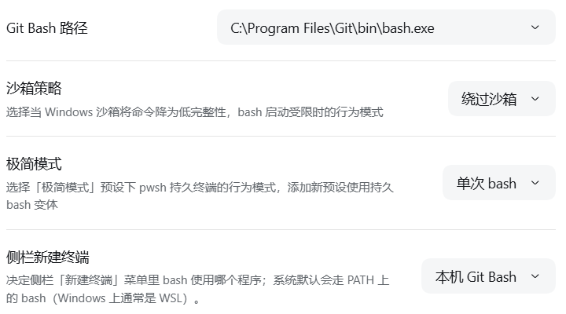
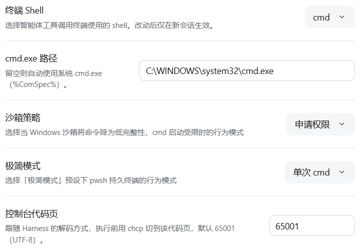

# dsh-terminal-shell

[English](README.md) | 中文

在 Windows 上选择智能体调用的终端工具背后用哪个 shell：**PowerShell**（`pwsh`）、**本机 Git Bash**（`bash`），或 **`cmd.exe`**（`cmd`）。

## 这是什么
DSH 每个平台只带一个终端工具，Windows 上那个工具是 PowerShell。本插件加了一个设置开关：选 bash 或 cmd，之后每个新会话的终端工具目录里出现该 shell 的工具、另一个 shell 的工具消失。已打开的会话保持原样。装上去什么都不改变：默认 dialect: 'pwsh' 与官方行为完全一致。

谁需要它：

- 你希望模型面前是 POSIX 工具链（git / ls / grep / sed / make / gcc），调用 bash；
- 你希望在 Windows 上使用系统自带的批处理语义，调用 cmd；

设计取向：**一个开关、所有 preset 跟随、不动 preset 文件、不接管全局 `ctx.shell`**。默认 `dialect: 'pwsh'`，装上去什么都不变；改成 `bash` 或 `cmd` 后，**新会话**拿到对应的工具，其它 shell 工具从该会话的工具目录里消失，已开的会话保持原状。所有配置字段都是 `volatile` 的，只在会话创建时取一次快照——这也是「改动后仅在新会话生效」的来源。

| 项 | 值 |
|---|---|
| 版本 | `0.2.1` |
| 适用平台 | Windows（DSH Desktop / Web shell） |
| `engines.node` | `>=22` |
| `engines.dsh` | `>=0.2.1-rc.2 <0.3.0` |
| 许可 | MIT |

> **临时替代方案**：DSH 目前没有内置的「终端 / shell 选择」能力。**在官方能力落地前，本插件是它的临时替代方案**——用官方已发布的执行器与工具，把 Windows 上新会话的终端换掉；Windows 受限沙箱档位下的 `confinedPolicy` 同属这段临时接线。**官方提供等价设置后即可停用本插件**：从 profile 依赖里移除本行并重启，新会话即回到官方终端工具。插件不改 DSH 安装目录、不改任何 preset、不接管全局 `ctx.shell`，配置只写进当前 profile 的 patch 层；卸载不需要清理任何全局状态。`minimalMode: variant` 是这条界线上的例外，但不是对它的破坏：持久终端版本以**新增预设** `minimal-gitbash` 的形式注册，官方 `minimal` 预设原样保留；没有会话再引用它时，这个预设会自行消失。详见下文「极简模式」一节。

---

## 为什么要这个插件

DSH 0.2.1-rc.2 的平台组合在 Windows 上是互斥的——bash 家族被 `!!js` 平台断言关掉：

```yaml
- id: bash-sandbox
  name: '@deepseek-ai/dsh-bash-sandbox'
  disabled: !!js process.platform === 'win32'
- id: pwsh-sandbox
  name: '@deepseek-ai/dsh-pwsh-sandbox'
  disabled: !!js process.platform !== 'win32'
- id: tool-bash          # 同样的平台断言
- id: tool-pwsh
```

同时 `ctx.shell` 是**单实例服务**（同一个 context 内加载第二个会抛 `service "shell" has been registered`），所以 Windows 上根本没有 bash 执行器，`bash` 工具也不存在。想用 Git Bash 只有三条路：

| 路线 | 代价 |
|---|---|
| 改 `dsh-base` / profile patch 的平台断言 | 要动第一方组合，重启，且只影响那一个平面 |
| 自研 PTY / 自研工具 | 重写 60KB+ 的工具契约，容易与官方行为漂移 |
| **本插件：会话级隔离替换** | 只在新会话的 `isolate('shell')` 子树里注入执行器，宿主平面不动 |

本插件选第三条：不抢全局 `ctx.shell`，只在**每一个新会话**自己的局部 realm 里装配。

---

## 能力概览

三种方言共用同一套设置行与配置，差别只在于工具、执行器与传输方式：

| 方言 | 工具名 | 执行器 | 传输 | 适用场景 |
|---|---|---|---|---|
| `pwsh`（默认） | `pwsh`（官方，原样保留） | 平台自带的 pwsh 执行器 | 原生 | 装插件但不想改变任何行为 |
| `bash` | `bash`（官方 `@deepseek-ai/dsh-tool-bash`） | `GitBashExecutor extends LocalBashExecutor` | `[bash.exe, -c, <command>]`，用配置的绝对路径 | 需要 POSIX 工具链（git / ls / grep / sed / make / gcc…） |
| `cmd` | `cmd`（自研 `src/cmd/tool.ts`，官方 `dsh-tool-bash` 的逐字移植） | `CmdExecutor extends LocalBashExecutor` | 每次写临时 `.cmd` 脚本，`cmd.exe /d /q /c <脚本裸名>` | 只需要系统自带的 `cmd.exe`，没装 Git Bash |

- `bash` / `cmd` 都会把被替换会话里的 `pwsh` 从工具目录隐藏（`cmd` 连继承来的 `bash` 也隐藏），并压空对应的 `tool:pwsh` 提示词段。
- 超时、输出收集与溢出、abort 分类、后台作业、`sandbox_permissions` 升级、会话 cwd、工具卡片、退出码标记全部继承或复用官方实现。
- `bash` 复用官方 `@deepseek-ai/dsh-tool-bash`；`cmd` 因为官方工具名与执行器都绑死在 `bash`/`pwsh` 上，用逐字移植的独立实现（见 [CMD 方言的限制](#cmd-方言的限制)）。
- **同时让侧边栏交互终端用上本机 Git Bash。** bash 分组的最后多了一个「侧边栏终端」设置（`sidebarBash`），决定侧边栏 **新建终端 → Shell** 菜单里的 `bash` 启动哪个程序。选「本机 Git Bash」时，插件在运行期通过 `discoverBash()` 解析本机的 Git Bash（不固定任何路径），并把单一 `config.shell` 覆盖**在内存里**交给核心 `terminal-controller`，于是该菜单的 `bash` 项启动的是本机 Git Bash（MINGW64/MSYS2），而不是 WSL 的 `bash`。菜单标签始终是 `bash`（不会变成 `bash.exe`）。详见 [与其他插件共存](#与其他插件共存)。

### 工作原理：会话级隔离替换

插件本身不实现终端，只在 `agent/created` 时对一个新会话做四件事（全部复用第一方组件；`cmd` 是唯一例外，见上表）：

```
shellCtx = agentCtx.isolate('shell')                // 该 agent 私有的 shell realm
shellCtx.plugin(GitBashExecutor, {...})             // 只在这个子树里可见
shellCtx.plugin(ToolBash, {...})                    // 注册出的 bash 落在 agent 自己的工具层
agentCtx.tools.restrict({ deny: ['pwsh'] })         // 只过滤「继承来的」工具
agentCtx.systemPrompt.section({ name: 'tool:pwsh', text: '' })  // 空文本=渲染时丢弃
```

- **不接管全局 `ctx.shell`**：全局替换会让所有会话（含没选 bash / cmd 的）跟着变，并与宿主平台的执行器冲突。
- **`restrict` 只过滤继承层**：官方语义是 "never what its OWN layer registers"，所以从 agent scope 调 `restrict({deny:['pwsh']})` 恰好只隐藏 preset 带进来的 `pwsh`，不影响本层注册的 `bash`；`cmd` 方言用 `restrict({deny:['pwsh','bash']})` 隐藏两个继承工具（先 `tools.get` 确认可见，隐藏不存在的名字会抛错）。
- 四步都登记在 `agentCtx` 上，会话结束由 cordis 逆序释放；中途失败则逆序回滚，会话退化为原样。
- **只对新会话生效**：工具与 prompt 是会话创建时装配的，运行中换不掉——这是 DSH 的语义，不是插件的取舍。

---

## 安装 / 启用

### 前置条件

- **Windows 平台**：`cordis.patch.yml` 的 `disabled: !!js process.platform !== 'win32'`，非 Windows 上整行不加载。
- DSH Desktop `>=0.2.1-rc.2 <0.3.0`（`package.json` 的 `engines.dsh`）。
- 用 `bash` 方言：本机已装 Git for Windows（或 MSYS2 / Cygwin）。
- 用 `cmd` 方言：只需要系统自带的 `cmd.exe`（`%ComSpec%`），无需额外安装。

### 步骤

```powershell
# 1. 构建（产物在 lib/）
git clone https://github.com/road-kid/dsh-terminal-shell.git
cd dsh-terminal-shell
npm install
npm run check        # typecheck → build → contractcheck → clientsmoke → selftest → rowselftest → rendertest → cmdunit → integration → cmdtest → ptytests

# 2. 装进 profile（本机 profile 为 desktop）
#    用插件管理器从本地目录安装：
#    plugin_manager install_bundle → target = 本仓库的绝对路径
npm pack
# 或把 tarball / 目录放进 profile 的依赖里，例如
#   C:\Users\<you>\.dsh\profiles\desktop\package.json
```

插件包自带 `dsh.bundle.patch`（`package.json` 的 `dsh.bundle.patch = ./cordis.patch.yml`），profile 的组合层会读取它，只插入一行：

```yaml
# 插件自身的一行（智能体工具的方言）
- insert:
    - id: terminal-shell
      name: dsh-terminal-shell
      disabled: !!js process.platform !== 'win32'
```

补丁只插入这一行，别的什么都不做：`cordis.patch.yml` 里不固定任何可执行文件路径，因此在任何机器上都一样。

- **`dialect` 默认 `pwsh`**：只装插件、不切方言，会话行为与官方完全一致。
- **安装或升级后必须重启 DSH**：运行中插入的 row 只进组合树，插件的 `apply` 不会被调用。

### 启用

重启后打开 **设置 → 通用**，底部会多出一行 **终端 Shell**（客户端半区注册的 `settings.general.item` 行，id `terminal-shell`，order `60`，locale 命名空间 `terminal-shell`）：

```
终端 Shell                                              [cmd ▾]
选择智能体工具调用终端使用的 shell。改动后仅在新会话生效。
cmd.exe 路径                              [C:/WINDOWS/system32/cmd.exe]
沙箱策略                                            [申请权限 ▾]
极简模式                                              [单次 cmd ▾]
控制台代码页                                                [65001]
```

（上面是选中 `cmd` 后的样子；默认 `pwsh` 时只有首行。）

`bash` 与 `cmd` 两种方言下的实际设置行：





---

## 使用

设置行的版式与官方 General 段设置行一致：左列标题（14px/22px）+ 每行一句说明（12px/18px），右侧控件；24px 列间距、16px 纵向内边距、`.5px` 底部分隔线（`--dsw-alias-border-l2`，仅整组最后一行去掉）。颜色全部取 `--dsw-alias-*` 设计变量，跟随主题。**每一行只有「标签 + 一句说明 + 控件」三件东西**。

### 文案（以 `src/client/locales.ts` 为唯一权威）

| 行（出现在哪个方言） | 文案 / 选项 | 写入字段 |
|---|---|---|
| 首行（全部） | 标题「终端 Shell」；说明「选择智能体工具调用终端使用的 shell。改动后仅在新会话生效。」；下拉「终端类型」，选项是小写程序名 `powershell` / `bash` / `cmd` | `dialect` |
| 路径（`bash`） | 「Git Bash 路径」，placeholder「例如 C:/Program Files/Git/bin/bash.exe」；为空且未扫描时提示「选择 Git Bash 后会自动扫描本机；也可以直接填入 bash.exe 的完整路径。」 | `bashPath` |
| 沙箱策略（`bash`） | 「沙箱策略」，选项 `绕过沙箱`（`unconfined`）/ `申请权限`（`escalate`） | `confinedPolicy` |
| 极简模式（`bash`） | 「极简模式」，选项 `保持 pwsh`（`leave`）/ `单次 bash`（`oneshot`）/ `添加新预设`（`variant`） | `minimalMode` |
| 侧边栏终端（`bash`，末行） | 「侧边栏终端」，说明「决定侧边栏「新建终端」菜单里 bash 使用哪个程序；系统默认会走 PATH 上的 bash（Windows 上通常是 WSL）。」，选项 `系统默认`（`system`）/ `本机 Git Bash`（`gitbash`） | `sidebarBash` |
| 路径（`cmd`） | 「cmd.exe 路径」，placeholder「例如 C:/Windows/System32/cmd.exe」（无说明，与 bash 路径行一致） | `cmdPath` |
| 沙箱策略（`cmd`） | 「沙箱策略」，选项与 `bash` 同一套：`绕过沙箱` / `申请权限` | `cmdConfinedPolicy` |
| 极简模式（`cmd`） | 「极简模式」，选项 `保持 pwsh`（`leave`）/ `单次 cmd`（`oneshot`） | `minimalMode` |
| 控制台代码页（`cmd`） | 「控制台代码页」，默认 `65001`，数字输入 | `cmdCodePage` |

- **顺序**：`cmd` 与 `bash` 一致——路径 → 沙箱策略 → 极简模式（`cmd` 末尾多一行控制台代码页）；`bash` 末尾还会多一行「侧边栏终端」。`bash` 专属字段（`loginShell` / `extraPath` / `pythonUtf8` / `bash` 的 `confinedPolicy`）在 `cmd` 下隐藏，反之亦然。
- **方言下拉是一枚官方下拉触发器**，点开是官方 `Menu`，与官方段里所有枚举型偏好的渲染方式相同。

### 方言切换即扫描

扫描是「选 shell」的后果，不是独立动作：**把方言切到 `bash` / `cmd` 就触发一次扫描**，没有单独的检测按钮。

- 路径控件默认是官方 `Input`，可以直接填可执行文件完整路径；**扫描命中多于一条时，输入框换成同一套下拉**，列出全部可用路径。
- 扫描中该位置显示「正在扫描…」；扫不到会明确提示，而不是清空输入。
- **已经选好的、仍然有效的路径不会被后续扫描改写**。
- 切换这一下正是最可能撞竞态的时机（同一 revision 上还排着方言写入），所以写入被拒或扫描请求失败都会**自动重试一次**（间隔 120ms），不会再出现「第一次切换没找到、再切一次才有」。
- **挂载时不扫描、不写配置**：`/state` 只读配置，所以打开设置是瞬时的；扫描只在切换到 `bash` / `cmd` 时发生。

### 沙箱策略两值的含义，以及默认为何不同

两个方言各有一个独立的沙箱字段（`confinedPolicy` 给 `bash`，`cmdConfinedPolicy` 给 `cmd`），设置行按当前方言只显示对应的那个。取值都只有两种：

| 值（界面） | 行为 |
|---|---|
| `绕过沙箱`（`unconfined`） | Windows 受限档位下**直接以普通权限启动**，不调用 `ctx.sandbox.confine()`；一次调用即成功，但模型命令**不受文件沙箱限制** |
| `申请权限`（`escalate`） | 先按官方方式进入沙箱；`bash` 的 MSYS 启动失败被标为 `denied`，模型收到官方升级提示后带 `sandbox_permissions: danger-full-access` 重试，由宿主审批 |

**默认值不同是刻意的**（`bash` 默认 `unconfined`，`cmd` 默认 `escalate`）：

- **`bash` 默认 `unconfined`**：MSYS2 / Git Bash 在 Windows 受限令牌下起不来——初始化命名共享内存时被拒（`NtCreateDirectoryObject` 失败 → `0xC0000022`）。如果默认 `escalate`，每条命令都会先失败一次再走审批；默认直启才能一次成功。
- **`cmd` 默认 `escalate`**：`cmd.exe` 能在受限令牌下正常启动（官方 windows-acl 沙箱后端的探针本身就是 `cmd /c exit 0`），所以走真实沙箱既可约束命令、又不会失败。

**工具声明**：`unconfined` 直启时执行器不向工具声明受限档位（`sandboxMode` 返回 `undefined`），模型不会被告知「命令在沙箱内」；结果里的 `sandbox.mode` 报 `danger-full-access`，这是这次调用**实际**的边界。`escalate` 走 `confine()`，`mode` / `enforcement` 保持官方原值。

**安全含义**：`unconfined` 是显式的产品选择——Windows 受限档位下不这样就没有可用的 Git Bash；它意味着模型通过 `bash` 执行的命令不受文件沙箱约束。需要沙箱约束时选 `escalate`（官方审批）。审批完全由第一方 `dsh-tool-bash` 负责，插件只把 MSYS 启动失败分类成 `denied`，不自己实现审批。

### 极简模式（`minimalMode`，仅 `bash` 有意义）

官方 `minimal` 预设是唯一自带持久 shell 的出厂预设（Windows 上是持久 pwsh）。所以 `bash` 方言下 `minimal` 会话需要单独决定怎么处理：

| 值（界面） | 含义 |
|---|---|
| `leave`（保持 pwsh） | 插件不介入官方 minimal 预设，保留其持久 pwsh 终端 |
| `oneshot`（单次 bash，默认） | `minimal` 会话改用一次性 bash 工具（`cmd` 方言下是一次性 cmd），`bash` 替换、`pwsh` 隐藏 |
| `variant`（添加新预设） | 额外注册 `minimal-gitbash` 预设（持久 bash 变体）；官方 `minimal` 原样不动。没有会话再引用它时自动移除 |

- `cmd` 方言只提供 `leave` / `oneshot`——`cmd` 没有持久终端后端，不提供「添加新预设」。
- `variant` 的变体行嵌入的是**注册那一刻**解析出的 Git Bash 绝对路径；之后改 `bashPath`（或 `confinedPolicy` / `loginShell` / `pythonUtf8`）会让定义按新输入重建，已在运行的变体会话仍跑旧那版。
- **变体不是自动生效的**：必须每个新会话手选一次「极简模式 · Git Bash」；关掉选项时若仍有会话引用 `minimal-gitbash`，定义会保留（`retained`）并显示引用数——删掉定义会让那些会话永久打不开。

### 控制台代码页（`cmdCodePage`）

`cmd` 会话执行前用 `chcp <codePage>>nul` 切到该代码页，默认 `65001`（UTF-8），这是唯一能让非 ASCII 输出存活的值。改小代码页会让中文变替换字符。客户端严格只接受正整数，非法输入回退到 `65001`。

### 路径发现顺序

**Git Bash（`bash` 方言）**：`bashPath` 为空且 `autoDiscover` 为真时，按下列顺序找，命中即止（`discoverBash`）；扫描器 `scanBashCandidates` 用同一套顺序但**列出全部**候选：

1. 显式 `bashPath`（会话装配时显式路径即答案，不再整机扫描）
2. `bashCandidates` 里的每一项（展开为 `bin\bash.exe` / `usr\bin\bash.exe` / `bash.exe`）
3. 注册表 `HKLM\SOFTWARE\GitForWindows` 的 `InstallPath`
4. `%ProgramFiles%\Git`、`%ProgramFiles(x86)%\Git`、`%LocalAppData%\Programs\Git`
5. `%ProgramFiles%\MSYS2`、`%SystemDrive%\msys64`、`%LocalAppData%\MSYS2`
6. `%SystemDrive%\cygwin64`、`%SystemDrive%\cygwin`
7. PATH 上 `git.exe` / `git.cmd` / `git.bat` 反推（`<root>\bin\bash.exe`）

**WSL 被硬排除**：`C:\Windows\System32\bash.exe` 和 `WindowsApps\bash.exe` 都不是 Git Bash，交给执行器会得到另一个操作系统和另一套文件系统，发现阶段直接拒绝并记下原因。

发现只做文件系统探测（`statSync`）+ 一次异步 `reg.exe query`，**不会 spawn `bash --version`**——宿主在 `agent/created` 里串行派发事件，同步 spawn 会卡住整个进程。一次扫描受 `discoverTimeoutMs` 约束。

**cmd.exe（`cmd` 方言）**：`cmdPath` 为空时依次尝试 `cmdPath` → `%ComSpec%`（也认 `COMSPEC`）→ `%SystemRoot%\System32\cmd.exe`（也认 `SYSTEMROOT` / `windir`）。**不扫描磁盘**——`cmd.exe` 没有第二个合理位置。非 `cmd.exe` 的 `cmdPath` 视为未设置。三步全部落空时该会话跳过替换（`reason=cmd-not-found`），保留官方 `pwsh` 工具。

### PATH 组装

执行时子进程 PATH = `工具链 bin`（`ucrt64`/`mingw64`/`clang64`/`mingw32`）→ `usr\bin` → `bin` → `usr\local\bin` → `extraPath` → **宿主 PATH**。

顺序是有意的：MSYS2 的 `git`/`ls`/`grep` 必须赢过 Windows 上的同名同源工具，而宿主 PATH 必须保留，否则 `node`/`python` 等原生命令会消失。去重按「小写 + 去尾分隔符 + `/`→`\`」归一化。

---

## CMD 方言的限制

`cmd` 是唯一**不建立在官方 `dsh-tool-bash` 之上**的方言（`src/cmd/tool.ts` 是官方工具的逐字移植），下面这些约束全部来自 `cmd.exe` 与批处理语义，不是插件的取舍：

1. **一次性批处理**：每次调用都是一个全新的临时 `.cmd` 脚本，`pause`、`set /p`、任何交互式提示都会挂到超时。执行器不可交互。
2. **回显无法恢复**：`cmd.exe /q` 关掉命令回显，命令原文不会出现在输出里，只有命令自己打印的东西会返回；脚本里写 `@echo on` 也压不过 `/q`。
3. **`%~dp0` / `%0` / `%1`–`%9` / `%*` 指向插件的内部脚本**，不是调用者写的那行命令；取工作目录要用 `%CD%`。
4. **`%VAR%` 按批处理规则展开**：同一行的 `set` 对新变量在当行还不可见。
5. **非 ASCII 输出依赖控制台代码页**：默认 `chcp 65001`，可用 `cmdCodePage` 改；改小会让中文变替换字符。
6. **`cmdPath` 只接受 `cmd.exe`**：填 bash 或其它程序会被客户端拒绝并提示（`row.cmdPath.invalid`），发现流程也用 `isCmdExecutable` 判定为无效；留空自动用 `%ComSpec%` → `%SystemRoot%\System32\cmd.exe`。
7. **没有持久 PTY**：`cmd` 方言不提供持久终端，`minimal` 预设的持久 shell 不会被替换（`minimalMode` 只对 `bash` 有意义）。
8. **沙箱拒绝标记可能缺失**：中文 Windows 上 `cmd` 的拒绝信息是 GBK 中文，provider 的英文签名匹配不上，`sandbox.denied` 可能为 `false`——沙箱本身仍然生效，插件不伪造这个判定。

传输实现细节（为什么每次落一个临时 `.cmd` 脚本）：`cmd.exe` 不能像 `bash -c` 那样把命令当参数传——单元素、多元素、环境变量、stdin 四种传法都会在引号、`%PATH%` 展开或多行上失败。所以每次执行在**每个执行器自己的 scratch 目录**（`os.tmpdir()` 下 `dsh-cmd-<pid>-<uuid>`）写一个 `cmd-<uuid>.cmd`，脚本形如：

```bat
@echo off
chcp 65001>nul
cd /d "<工作目录>" 2>nul || (echo cmd: cannot enter the working directory 1>&2 & exit /b 1)
<模型给的命令原文>
```

- **`cd` 守卫不是装饰**：脚本从 scratch 目录启动，工作目录若已不存在，没有守卫时命令会在 scratch 目录里静默执行并 `exit 0`；UNC 路径改用 `pushd`。
- **没有尾部 `exit /b %errorlevel%`**：`cmd` 脚本的退出码本来就是最后一条命令的退出码，显式写反而会改掉 `dir /nonexistent & echo recovered` 这类命令的 `0`。
- **文件名以裸名传给 `cmd.exe`，`cwd` 设为脚本目录**：唯一能扛住 scratch 路径里出现 `&` `(` `)` `^` `,` `;` `%` 的形态（绝对路径形态在这些字符下全部失败）。
- 脚本 UTF-8 无 BOM、CRLF 写入；每个执行器在 `ctx.effect` 里回收自己的 scratch 目录，插件启动时 `sweepStaleScripts()` 清掉 24 小时前的残留。

---

## 配置字段表

所有字段逐个 `.volatile()`，由 Host 交给官方 `configForms`；设置行直接编辑其中一部分，其余仍可直接写 profile patch。字段与 `src/config.ts` 一一对应：

| patch key | 类型 | 默认值 | 含义 |
|---|---|---|---|
| `dialect` | `'pwsh' \| 'bash' \| 'cmd'` | `'pwsh'` | 终端方言；`pwsh` 行为不变 |
| `bashPath` | `string` | `''` | 显式 `bash.exe` 绝对路径；留空 = 自动发现 |
| `bashCandidates` | `string[]` | `[]` | 额外发现根 / 显式可执行，先于内置顺序；也存上次扫描的可用路径 |
| `autoDiscover` | `boolean` | `true` | `bashPath` 为空时是否在装配会话时自动发现 |
| `discoverTimeoutMs` | `number` | `1500` | 一次发现的上限（只 stat 文件系统，不 spawn） |
| `loginShell` | `boolean` | `false` | 传 `-l`，读取登录 profile |
| `extraPath` | `string[]` | `[]` | 追加到子进程 PATH 的目录 |
| `pythonUtf8` | `boolean` | `true` | 导出 `PYTHONIOENCODING=utf-8` |
| `confinedPolicy` | `'unconfined' \| 'escalate'` | `'unconfined'` | `bash` 在受限档位下的处理方式 |
| `cmdPath` | `string` | `''` | 显式 `cmd.exe` 绝对路径（只接受 `cmd.exe`）；留空 = `%ComSpec%` → `%SystemRoot%\System32\cmd.exe` |
| `cmdCodePage` | `number` | `65001` | 脚本里 `chcp` 的代码页 |
| `cmdConfinedPolicy` | `'escalate' \| 'unconfined'` | `'escalate'` | `cmd` 在受限档位下的处理方式 |
| `minimalMode` | `'leave' \| 'oneshot' \| 'variant'` | `'oneshot'` | 官方 `minimal` 预设的处理方式 |
| `sidebarBash` | `'system' \| 'gitbash'` | `'system'` | 侧边栏「新建终端」菜单里的 `bash` 启动哪个程序；`gitbash` 在运行期解析本机 Git Bash 并在内存里覆盖核心 controller，`system` 保持 PATH 原有菜单 |
| `timeoutMs` | `number` | `120000` | 继承自官方 bash 执行器的单命令超时 |
| `maxTimeoutMs` | `number` | `600000` | 允许的最大超时 |
| `maxOutputBytes` | `number` | `64000` | 前台输出上限 |
| `maxSpillBytes` | `number` | `67108864` | 溢出到文件的字节上限（64 MiB） |
| `graceMs` | `number` | `3000` | 终止进程的宽限时间 |

> `confinedPolicy` 与 `cmdConfinedPolicy` 都**只有** `unconfined` / `escalate` 两值（0.2.1 从 schema 移除了 `fail`，profile 里写 `fail` 会 schema 校验失败，见[排错](#诊断与排错)）。

---

## 卸载

1. 从 profile 依赖里移除 `dsh-terminal-shell` 这一行（`cordis.patch.yml` 插入的 `terminal-shell`）。
2. **重启 DSH**，新会话回到官方终端工具。

- **无全局残留**：插件不写 `ctx.shell`、不改任何已加载的 preset、不写宿主安装目录，效果只落在会话创建时替换的那个会话上。
- **`variant` 预设自动清理**：插件卸载时变体管理器 `release()` 注销 `minimal-gitbash` 定义（插件不在了，定义也留不住）；若仍有会话引用，它按 `retained` 语义保留，直到没有引用。
- 已按 Git Bash / cmd 装配的**已开会话不会切回 pwsh**（工具与 prompt 段在会话创建时定稿）。

---

## 诊断与排错

诊断日志（每次会话一行）：

```
%TEMP%\dsh-terminal-shell.log
```

用环境变量 `DSH_TERMINAL_TOOL_DIAG_FILE` 覆盖路径。典型行：

```
[2026-10-18T02:10:00.000Z] ok session=... bash=C:\Program Files\Git\bin\bash.exe source=registry path=4 entries
[2026-10-18T02:10:00.000Z] ok session=... cmd=C:\WINDOWS\system32\cmd.exe source=comspec codepage=65001 confined=escalate
[2026-10-18T02:10:00.000Z] skip session=... reason=bash-not-found: C:\Program Files\Git\bin\bash.exe: file does not exist
[2026-10-18T02:10:00.000Z] skip session=... reason=cmd-not-found: no cmd.exe via cmdPath, ComSpec or %SystemRoot%
[2026-10-18T02:10:00.000Z] skip session=... reason=already-replaced
```

`reason` 取值：`not-win32` / `dialect-pwsh` / `no-agent-context` / `already-replaced` / `bash-not-found` / `cmd-not-found` / `missing-service` / `minimal-left` / `mount-failed` / `cmd-script-failed` / `cmd-mount-failed`。`minimal-left` 表示会话用 `minimal` 预设且 `minimalMode` 为 `leave` / `variant`，插件按设计让开；`dialect-pwsh` 表示方言是 `pwsh`（或 cmd 会话里的 bash 路径判定），插件不介入。

常见症状与处置：

| 症状 | 原因 / 处置 |
|---|---|
| **改完设置没反应，「工具目录还是旧的」** | 工具目录与 prompt 段在**会话创建时定稿**。设置改的是 patch 层 entry Config，对已装配的会话无效。**新建会话**才会用新值 |
| **重启后仍然没有新工具** | 重启前已打开的会话（含恢复出来的旧会话）不会被重新装配，日志里连一行都不会出现。**完全退出并重启宿主，然后新建会话**，别在旧会话里复测 |
| **日志里没有该会话的行** | `agent/created` 根本没为它触发过——会话建得比插件早。处置同上 |
| **`bash-not-found`** | 把 `bashPath` 显式指到 `C:\Program Files\Git\bin\bash.exe` 试试 |
| **`cmd-not-found`** | 把 `cmdPath` 显式指到 `C:\WINDOWS\system32\cmd.exe` |
| **`mount-failed` / `cmd-mount-failed`** | `detail` 里是 cordis 的原始错误（常见是配置校验或服务缺失） |
| **profile 里写 `confinedPolicy: fail` 启动失败** | `fail` 在 0.2.1 已从 schema 移除，**不再合法**；改成 `unconfined` 或 `escalate` |
| **`cmdPath` 填了 bash 被拒** | `cmdPath` 只接受 `cmd.exe`，客户端会提示并拒绝写入；改成 `cmd.exe` 的完整路径 |

插件永不因自身问题让会话创建失败：`agent/created` 是串行派发的，监听器抛错会让 agent 注册失败，所以整个监听体是防御式的，任何异常只落日志。

---

## 开发

目录结构：

```
src/index.ts      插件入口：apply / Config / agent 事件 / 能力探测
src/config.ts     schemastery Config（全 volatile）+ 会话级快照
src/discover.ts   Git Bash 自动发现（含 WSL 排除）
src/paths.ts      路径算术：安装根、PATH 条目、校验、PATH 合成
src/executor.ts   GitBashExecutor（继承 LocalBashExecutor，含沙箱分支）
src/confined.ts   受限沙箱启动决策（planLaunch）与 MSYS 启动失败签名
src/cmd/          cmd 方言：types.ts 契约、script.ts 临时 .cmd 脚本传输、
                  discover.ts 发现、executor.ts（CmdExecutor + planCmdLaunch）、
                  tool.ts（cmd 工具）、prompt.ts 提示词段
src/preset.ts     预设变体管理：克隆官方 minimal 行、注册 / 注销、引用计数
src/pty.ts        dsh-terminal-shell/pty 入口：注册 gitbash 类型的持久终端后端
src/replace.ts    每会话替换 + 逆序回滚（bash 与 cmd 两条装配路径）
src/sidebar.ts    把侧边栏「新建终端」的 bash 选择在内存里应用到核心 terminal-controller
src/diag.ts       诊断日志
src/routes.ts     两条 /api 路由：/state 与 /discover（都不写配置）
src/shared/protocol.ts  Host/客户端共享的线路协议（路由路径、常量、视图类型）
src/client/       客户端半区：设置 → 通用 的「终端 Shell」行
                  index.ts 注册 settings.general.item；row.tsx 行组件；
                  store.ts 状态机；api.ts 取数；styles.ts 只放版式；locales.ts 文案
src/testing.ts    仅测试用的第二入口（不发布）
```

### 脚本

```powershell
npm run typecheck     # tsc --noEmit（devDeps 钉 0.2.1-rc.2 真 .d.ts）
npm run build         # esbuild → lib/index.js（Host ESM）+ lib/client.js（客户端半区）+ lib/pty.js（持久终端入口）
npm run check         # 依次跑下面所有测试
```

- `npm run contractcheck`（**19**）：Config 全 volatile / patch 行 / 导出面 / 客户端装载形状 / bundle 未内联第一方 / atom specifier 保持 external。
- `npm run clientsmoke`（**8**）：真实执行 `lib/client.js`——模块装载形状、react 与 atom external、apply 注册行、无 `configForms` 时降级、迟到服务替换、HMR 幂等。
- `npm run selftest`（**51**）：路径、发现、快照、受限启动决策、`/api` 路由注册、预设行克隆与变体生命周期。
- `npm run rowselftest`（**19**）：行状态机——`/state` 读取、乐观写入、切方言即扫描与重试、各类失败提示。
- `npm run rendertest`（**21**）：在 jsdom 里真实渲染并点击，按 role/aria 断言下拉触发器、菜单项与路径 Input（含 cmd 四行与 cmd 极简模式两项；官方 atoms 由 `scripts/primitives-double.mjs` 顶替）。
- `npm run cmdunit`（**37**）：cmd 单元测试——脚本模板、发现、启动判定，含真 spawn `cmd.exe`。
- `npm run integration`（**13**）：在真实第一方服务上跑完整替换流程。
- `npm run cmdtest`（**14**）：cmd 端到端矩阵——传输、引号、变量、多行、编码、退出码、cwd、超时、沙箱、装配。
- `npm run ptytests`（**3**）：在真实 ConPTY 上跑持久 Git Bash——注册、跨命令保持状态、escalate 拒绝（非 Windows 跳过）。

### 构建说明

`build.mjs` 用 esbuild 产出 plain ESM。第一方 `@deepseek-ai/*` 包保持 **external**（harness 通过安装作用域解析，内联会复制服务类并破坏 cordis 依赖的 `instanceof` / 身份检查）；客户端 bundle 把 `react` 与官方 UI atoms 也保持 external（页面会播种，内联第二份会破坏 hook 身份与 CSS-module 类名）。**esbuild 默认 `charset: 'ascii'`**，所以 bundle 里的中文字符串会写成 `\uXXXX` 转义——运行时仍是正确中文，只是产物里看不到原字面量。类型声明是手写 `.d.ts`（不经 `tsc --emitDeclarationOnly`），避免把整个第一方 `.d.ts` 图拖进包里。

---

## 兼容性

- **平台**：仅 Windows。`cordis.patch.yml` 的行带 `disabled: !!js process.platform !== 'win32'`，非 Windows 上不加载。
- **profile**：Desktop（Web shell）。设置行依赖 Web shell 自带的官方 UI atoms 模块表（`PLATFORM_MODULES`），Host 半区的替换逻辑不依赖这张表。
- **`engines.node`**：`>=22`。
- **`engines.dsh`**：`>=0.2.1-rc.2 <0.3.0`（本插件在此范围内开发与验证）。宿主大版本变更后需重新验证。
- **`@deepseek-ai/dsh-llm`** 是 `peerDependency`，构建时 external（不内联第一方类）。
- **与持久终端 bundle（如 `@deepseek-ai/dsh-experimental-terminal-bundle`）**：本插件的 `pty` 入口只在某个预设自己的持久终端组里注册 `gitbash` 后端；官方 bundle 拥有独立的 `terminals` 注册表与 `terminal_*` 工具，两者互不读写对方状态，可共存。

### 与其他插件共存

本插件的占用面（都带 `terminal-shell` / `dsh-terminal-shell` 前缀，冲突时以先加载者为准）：

| 面 | 名字 |
|---|---|
| 设置行 slot | `settings.general.item`，id `terminal-shell`，order `60` |
| locale 命名空间 | `terminal-shell` |
| bundle 行 id | `terminal-shell`（插入，`cordis.patch.yml`） |
| Host 路由 | `/api/dsh-terminal-shell/state`、`/api/dsh-terminal-shell/discover` |
| 会话内工具 | `bash` 方言：替换 `bash`、隐藏 `pwsh`；`cmd` 方言：新增 `cmd`、隐藏 `pwsh` 与 `bash`（仅被替换的会话） |

- **不写全局**：不改 `ctx.shell`、不改任何已加载的 preset、不写宿主安装目录，也不在 `cordis.patch.yml` 里固定任何可执行文件路径。当 `sidebarBash` 为 `gitbash` 时，它在内存里给核心 `terminal-controller` 一个 `config.shell` 覆盖（从不落盘）；`system` 时完全不碰该 controller。
- **与另一个 Git Bash 插件（如 `dsh-gitbash-shell`）同时安装**：两者都想替换会话的 `bash` 工具。本插件在发现同 scope 已有 `bash` 工具时跳过替换（`already-replaced`），但**不区分**那个 `bash` 是否来自本插件。只装一个即可。
- **与 UI 插件（侧边栏 / 快捷键等）**：只在设置页占用一行、一个 locale 命名空间；运行期可能（仅在 `sidebarBash` 为 `gitbash` 时）在内存里设置核心 `terminal-controller` 的 `config.shell`，无其它 DOM 或运行时全局状态。若另一个插件也配置 `terminal-controller`，以生成时实际生效的那份 config 为准。
- **热禁用**：禁用插件后，已按 Git Bash / cmd 装配的会话不会切回 `pwsh`；新会话恢复官方终端工具；变体预设随插件一起注销。

---

## 参考

- [`docs/DESIGN.md`](docs/DESIGN.md)：架构与模块设计（能力清单、决策理由、偏离项与待验证项，随代码维护）。
- [`docs/history/`](docs/history/README.md)：历史规划与评审归档（`PLAN-cmd-dialect.md`、`PLAN-confined-bash.md`、`PLAN-minimal-mode.md`、`REVIEW-cmd-dialect.md`）。注意其中版本号是重编号之前的旧编号，见 `CHANGELOG.md` 的「Version numbering」。
- [`CHANGELOG.md`](CHANGELOG.md)：版本变更记录（0.2.1 段落记录本次设置行改版、`fail` 移除与 `cmdPath` 校验）。
